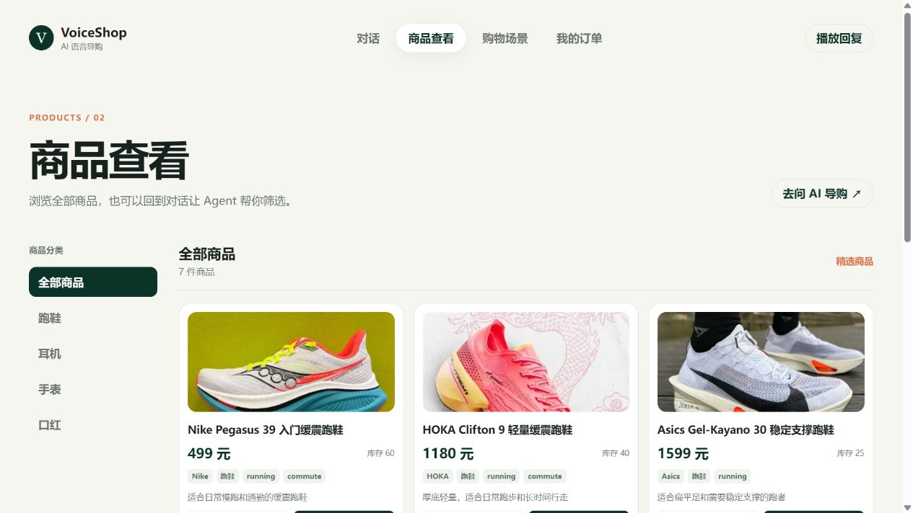

# VoiceShop AI

[简体中文](README.md) | [English](README_EN.md)

VoiceShop AI is an intelligent voice shopping assistant for e-commerce. Shoppers do not need to know the catalog structure or configure filters in advance. They can describe their needs in natural language, while the system combines multi-turn conversation, product retrieval, and knowledge Q&A to help narrow an open-ended request into relevant products and service information.

## Background

Conventional e-commerce search often asks shoppers to choose a category and fill in price, brand, or attribute filters first. Fixed filters are less effective when a shopper starts with a vague request, such as “a lightweight shoe for commuting,” then adds a budget, changes the use case, or excludes a preference over several turns. Shipping and after-sales questions may also require leaving the product page to search help content separately.

VoiceShop AI brings conversational need understanding, product discovery, knowledge retrieval, and voice interaction into one shopping journey. The focus is not merely generating recommendation copy: requirements should persist across turns and constrain subsequent retrieval, tool execution, and responses.

## Product UI

The screenshot below shows the VoiceShop AI catalog and shopping-assistant conversation interface.



## Project Highlights

### Conversational Need Understanding

LangGraph organizes the multi-turn shopping flow. The model interprets the shopper's current intent, while conversation context carries category, budget, use case, and preferences forward. Rules extract explicit slots such as category, budget, brand, use case, and exclusions; structured output and business validation constrain subsequent actions. The assistant asks a follow-up when information is missing and replaces outdated filters when the shopper changes their mind. Requests about the catalog, past orders, or after-sales policies are routed to their corresponding query paths.

### Constraint-Aware Recommendations

Shopper requirements become retrieval and filtering criteria. Candidate selection considers category, budget, use case, attributes, availability, and preferences. Product explanations connect those characteristics to the shopper's needs instead of relying on inventory availability as the only reason. Recommendations must respect the requested category and explicit constraints; when nothing matches, the assistant says so and suggests what could be adjusted instead of filling the results with unrelated products.

### Knowledge-Grounded Shopping Q&A

For product-service, shipping, and after-sales questions, the RAG flow parses and chunks knowledge materials with source metadata, then uses embeddings and vector retrieval to find relevant evidence for the response context. Answers are grounded in retrieved materials and retain their sources. If the retrieved content does not support a conclusion, the assistant follows an abstention or clarification path instead of presenting a model guess as platform policy.

### Voice Shopping Experience

Voice input and spoken responses share the same need-understanding and recommendation flow as text. Shoppers can continue with follow-up questions, product-detail requests, or preference changes without restarting the search.

### Quality and Reliability

Structured intent and slot results, product rules, and no-answer handling help address intent errors, lost constraints, and cross-category recommendations. Scenario-based evaluation covers multi-turn understanding, product filtering, knowledge Q&A, tool use, and fallback behavior. LangGraph makes workflow transitions explicit; traces capture model and tool calls, latency, and results to help locate failures across understanding, retrieval, validation, and response generation. Timeouts, rate limits, invalid structured output, and tool errors can route to retries, model fallback, clarification, or an explicit failure response.

## Technology Stack

| Area | Technologies | Application |
| --- | --- | --- |
| Service and orchestration | Python, FastAPI, LangGraph | API services, multi-turn state, and Agent workflow |
| Model and output validation | DeepSeek API, Pydantic, JSON Schema, Function Calling | Intent understanding, structured results, tool selection, and argument constraints |
| RAG and vector retrieval | LangChain, BGE Embeddings, PostgreSQL, pgvector | Document processing, semantic retrieval, evidence assembly, and source traceability |
| Persistence and cache | SQLAlchemy, PostgreSQL, Redis | Conversation and business data, vector index, and caching |
| Voice interaction | FunASR, WebSocket, browser speech synthesis | Streaming speech recognition and spoken responses |
| Quality and observability | Langfuse / LangSmith, traces, offline evaluation | Call-chain observability, failure analysis, and regression evaluation |

## Conversation Flow

```text
Voice or text input
        ↓
Understand needs using the current conversation context
        ↓
Validate conditions; clarify with the shopper when needed
        ↓
Retrieve products or knowledge and run the relevant business action
        ↓
Return recommendations with reasons, or an evidence-grounded answer
        ↓
Continue with follow-up questions, preference changes, or next steps
```

## Technical Architecture

| Layer | Responsibility | Key technologies |
| --- | --- | --- |
| Interaction | Catalog, assistant conversation, voice input, and spoken replies | HTML, CSS, JavaScript, WebSocket, FunASR |
| Agent orchestration | Multi-turn state, routing, clarification, and tool use | Python, LangGraph |
| Model | Intent understanding, contextual reasoning, response generation, and fallback | DeepSeek API, structured output, Pydantic |
| Retrieval | Product retrieval, knowledge chunking, semantic search, and evidence assembly | RAG, BGE Embeddings, pgvector |
| Data | Sessions, messages, products, orders, knowledge passages, and call records | PostgreSQL, SQLAlchemy, Redis |
| Quality and safety | Output validation, permission checks, tracing, regression, and safety evaluation | JSON Schema, offline evaluation, Langfuse / LangSmith |

## Key Design Decisions

- **Model for understanding, business logic for enforcement:** The model handles informal language and context; deterministic rules extract explicit conditions, while business validation enforces catalog constraints, permissions, and tool boundaries.
- **Honor the latest user intent:** Budget, category, preferences, and exclusions are updated incrementally. Explicit corrections and negations take precedence over stale conversation state.
- **Do not answer without evidence:** Product recommendations and knowledge answers are checked against their respective sources. When no match or supporting knowledge is found, the system explains this and offers clarification or adjustment paths.
- **Observable and evaluable execution:** Traces cover model, retrieval, tools, and final responses; scenario suites include normal requests, edge cases, unanswerable questions, and tool failures for regression checks.

## Evaluation Dimensions

Evaluation focuses on whether shoppers can complete their tasks, not only whether a response sounds fluent:

- **Intent understanding:** Category recognition, query type, negation, intent switching, and multi-turn context.
- **Product recommendations:** Category accuracy, budget compliance, exclusion handling, explanation quality, and no-match behavior.
- **Knowledge Q&A:** Retrieval hit rate, answer correctness, source coverage, and abstention accuracy for unanswerable questions.
- **Agent execution:** Tool choice and arguments, business validation, fallback behavior, end-to-end task completion, and latency.
